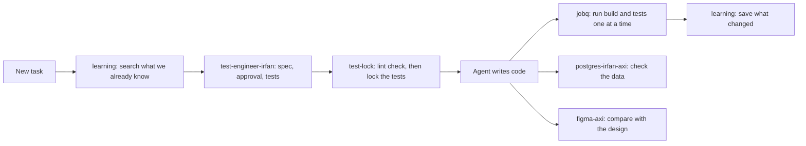

# ig-skills

Skills and small tools I use every day with [Claude Code](https://docs.claude.com/en/docs/claude-code).
Each one fixes a real problem I hit while letting an AI agent work on a big codebase:
it forgets what it learned, it edits tests to make them pass, it trusts a database
command that silently failed, it runs five heavy builds at once on a low-RAM laptop.

Every folder has its own README: what it does, why it exists, how it is built,
what it needs, how to install it, and its known limits.

## What is inside

| Name | Type | What it does |
|---|---|---|
| [learning](skills/learning/) | skill + hooks | A per-project knowledge base in `.learning/`. The agent searches it before reading code and writes back what it learned at the end of each session. |
| [test-engineer-irfan](skills/test-engineer-irfan/) | skill | Spec-first testing: write the rules, get them approved, write tests from the spec only, lock the tests, then let the agent write code. |
| [postgres-irfan-axi](skills/postgres-irfan-axi/) | skill + CLI | A safe bridge from the agent to a **local** Postgres: short output, structured errors, row counts as proof, refuses destructive commands. |
| [figma-axi](skills/figma-axi/) | skill + CLI | Read Figma files, styles, design tokens, renders and comments through the Figma REST API, with compact output. |
| [test-lock](tools/test-lock/) | tool + hook | Hash-locks test files so the agent cannot change them while it implements. Refuses to lock tests that fail lint or type checks. |
| [jobq](tools/jobq/) | tool + hook | One heavy job (build, test, lint, typecheck) at a time across every session on the machine, so the laptop does not run out of memory. |

## How they fit together

## Install

There is no install script on purpose: each README lists the exact steps,
so you can see what goes where. The usual shape:

1. Clone this repo, for example to `~/code/ig-skills`.
2. Symlink a skill folder into Claude Code's skills folder:
   `ln -s ~/code/ig-skills/skills/<name> ~/.claude/skills/<name>`
3. If the item has a CLI or hook, follow that README to put it on your `PATH`
   or register the hook in `~/.claude/settings.json`.

Most items are tested on macOS. Some parts (for example `lockf` in jobq) are macOS only;
each README says so.

## Naming

Skills that end in `-axi` follow the AXI idea: a command-line interface shaped for
agents, with short structured output (TOON) instead of long human text.

## Licence

[MIT](LICENSE)
