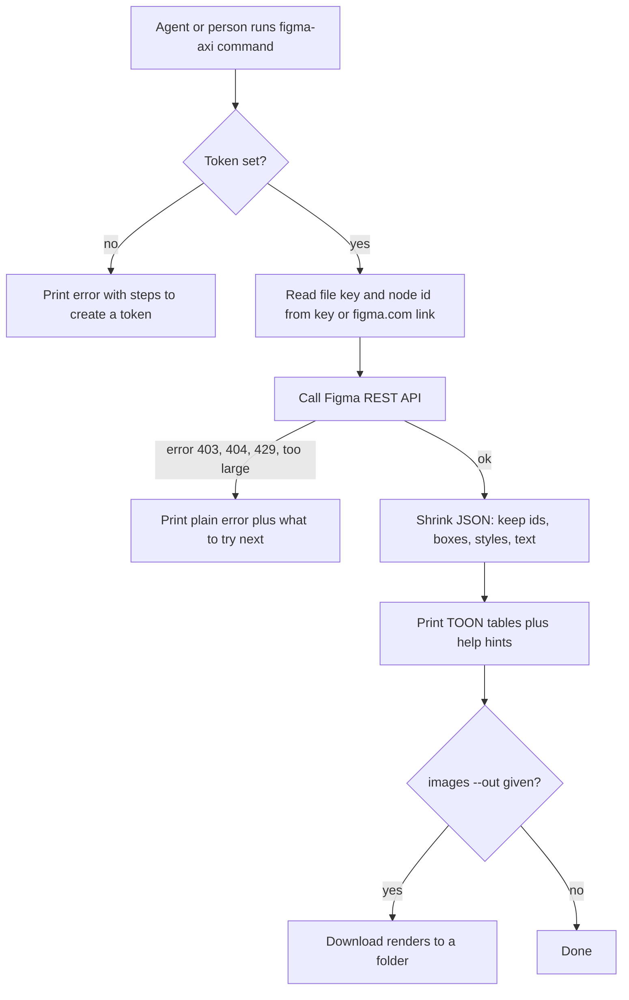

# figma-axi

A small command line tool and a Claude Code skill that read Figma designs through the Figma REST API.
It prints short TOON text instead of big raw JSON: pages, frames, layout trees, colours, text styles, renders and comments.
It only reads. It never changes a Figma file.

## Why it exists

The raw Figma API returns very large JSON. One page can be tens of megabytes.
An AI agent that reads that JSON wastes most of its context on noise.
Screenshots are worse: they lose exact spacing, hex colours and font weights.
figma-axi gives the agent the exact values in a few kilobytes, with a next-step hint after every answer.

## How it works



## Requirements

- Node.js 18 or newer (uses the built-in `fetch`). Tested on Node 24.
- No npm packages. Nothing to install with npm.
- A Figma personal access token in `FIGMA_TOKEN` (or `FIGMA_PERSONAL_ACCESS_TOKEN`).
  Create it at https://www.figma.com/settings, under Security, Personal access tokens.
- Optional: `FIGMA_FILE_KEY` makes the home view (no arguments) open that file.
- Optional: `FIGMA_API_BASE` changes the API address. It must be `https`; plain `http` is allowed only for `localhost` or `127.0.0.1`, because the token goes with every request. The tests use it to point at a local mock server.
- Network access to `api.figma.com` for real use.

## Install

Manual steps. There is no install script.

1. Clone the repo:
   ```sh
   git clone <this repo url> ~/code/ig-skills
   ```
2. Put the CLI on your PATH with a symlink:
   ```sh
   mkdir -p ~/.local/bin
   ln -s ~/code/ig-skills/skills/figma-axi/bin/cli.mjs ~/.local/bin/figma-axi
   chmod +x ~/code/ig-skills/skills/figma-axi/bin/cli.mjs
   ```
   Make sure `~/.local/bin` is on your `PATH`.
3. Give Claude Code the skill by linking the skill folder:
   ```sh
   ln -s ~/code/ig-skills/skills/figma-axi ~/.claude/skills/figma-axi
   ```
4. Export the token in your shell profile (for example `~/.zshenv`):
   ```sh
   export FIGMA_TOKEN=<your token>
   ```
5. Check it works:
   ```sh
   figma-axi me
   ```

## Usage

Anywhere `<key>` is shown you can also pass a full `figma.com/design/...` link.
A link with `?node-id=1-42` is enough for `node` and `images`.

```sh
figma-axi                                     # home view: token status and command list
figma-axi --help                              # all commands with usage
figma-axi node --help                         # flags and examples for one command
figma-axi me                                  # check the token
figma-axi file <key>                          # pages and top-level frames with node ids
figma-axi file <key> --page Onboarding        # frames on one page only
figma-axi node <key> 1:42                     # layout and style tree of one frame
figma-axi node "https://figma.com/design/KEY/N?node-id=1-42" --depth 4
figma-axi node <key> 1:42 --full              # raw Figma JSON (very large)
figma-axi tokens <key>                        # colours, text styles, effects with real values
figma-axi tokens <key> --page Onboarding      # scan one page when styles are not published
figma-axi tokens <key> --from 12:345          # scan one frame
figma-axi styles <key>                        # published style names only
figma-axi components <key>                    # components and component sets
figma-axi images <key> 1:42 --scale 2         # print signed render urls
figma-axi images <key> 1:42 --out ./shots     # download renders
figma-axi comments <key> --limit 10           # newest comments first
```

Exit codes: 0 ok, 1 error, 2 usage error. Errors print on stdout in the same TOON shape as data.

## Tests

Both tests run offline. The end-to-end test starts a mock Figma server on `127.0.0.1` and runs the real CLI against it. No token and no network needed.

```sh
node skills/figma-axi/tests/test.mjs   # unit checks, prints "ok"
node skills/figma-axi/tests/e2e.mjs    # 32 end-to-end cases against the mock API
```

## Limits and known gaps

- Read only. No writes, no Figma plugin API, no variables API.
- Figma refuses whole-file reads on large files. `tokens` then asks you to pass `--page` or `--from`.
- Unpublished (local) styles carry no values in the API. `tokens` reads each value off one node that uses the style, so it only finds styles that are used inside the scope you scan.
- `styles` and `components` return nothing when the file publishes no library. That is a real answer.
- Render urls from `images` expire fast. Use `--out` if you need the file later.
- `images --format` takes only `png`, `jpg`, `svg` or `pdf`. With `--out`, every render url must be `https` (or local `http`), and file names keep only `A-Za-z0-9_-` from the node id (`1:42` becomes `1-42.png`).
- Figma rate limits hard. A 429 means wait a minute.
- `letterSpacing` is printed as Figma returns it on nodes (pixels).
- Not published on npm. There is no `npx` form.

## Licence

MIT
