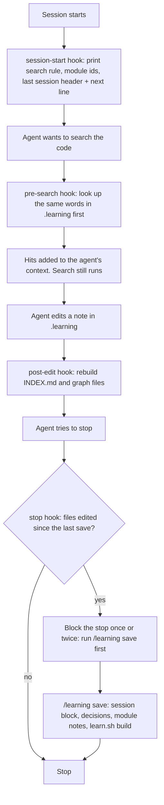

# learning

A Claude Code skill that gives each project a small, local "learning database" in `<repo>/.learning/`.
It holds what an agent learned about the codebase: the business process, one short note per module, every decision, and one verdict block per session.
A set of hooks makes the agent search this database before it greps the code, and reminds it to save what it learned before it stops.
The database is plain Markdown. It never leaves your machine (`.learning/.gitignore` is `*`).

## Why it exists

Every new agent session starts from zero. It re-reads the same files, re-discovers the same traps, and makes the same mistakes again.
That costs time and context, and the facts it finds die with the session.
The learning database keeps those facts between sessions:

- The next session reads a 40-line module note instead of 20 source files.
- Decisions are written down once (`D-0012 ... chose A over B because C`), so they are not argued again.
- Each session ends with a verdict and a `next:` line, so the next one knows where to start.

Search and rebuild are plain grep and Python. No LLM runs inside the tool.

## How it works



Layout of the database:

```text
.learning/
  .gitignore      "*" (local only)
  INDEX.md        generated: one row per note (id, type, summary, tags)
  graph.json      generated: notes and links as a graph
  graphify-out/   generated: graph for graphify queries (+ graph.html if graphify is installed)
  vault/          generated on request: an Obsidian vault
  CODEBASE.md     what the app is and should be: business, flow, stack, conventions
  modules/*.md    one note per module, max 40 lines
  DECISIONS.md    append-only, one line per decision (D-NNNN)
  SESSIONS.md     newest first, one block per session (S-NNNN)
  specs/          optional: specs written by the test-engineer-irfan skill
```

Linked git worktrees never get their own `.learning/`. The tool and every hook find the main checkout with `git rev-parse --git-common-dir`, so all worktrees read and write the same database.

### The hooks

| Hook | Event | What it does | Blocks? |
|---|---|---|---|
| `learning-session-start.sh` | `SessionStart` | If `.learning/INDEX.md` exists: prints the search rule, the ids of the `concept` and `guide` rows of `INDEX.md` (`+N more` for the rest), the newest `SESSIONS.md` header and its `next:` line into the agent's context, under 2 KB (Claude Code shows the agent only the first 2 KB of hook output). No database but a project file (`package.json`, `pyproject.toml`, `go.mod`, ...): prints one line that suggests `/learning onboard`. | no |
| `learning-pre-search.sh` | `PreToolUse`, matcher `Grep\|Glob\|Bash` | Takes the search words from a `Grep`/`Glob` pattern, or from a Bash `grep`, `rg`, `ag`, `ack` or `git grep` that starts a pipeline. Runs `learn.sh find --brief` on them and adds at most 3 INDEX rows and 3 DOC lines, 900 characters in all, to the agent's context. Same words, or a line already sent, for the same agent in the same session are not injected twice. Searches inside `.learning` and `... \| grep x` filters are skipped. A Bash call that runs `learn.sh find` itself is only logged. | no |
| `learning-post-edit.sh` | `PostToolUse`, matcher `Edit\|Write\|MultiEdit` | When the edited file is a `.md` under `.learning/`, runs `learn.sh build` to rebuild `INDEX.md` and the graphs. | no |
| `learning-stop.sh` | `Stop` | Reads the session transcript and counts real file writes by the agent since the last save (a write to `SESSIONS.md` or a `learn.sh build` counts as the save). If there are unsaved writes, it blocks the stop and tells the agent the exact `/learning save` steps. At most 2 blocks per session, then it stays quiet. | yes, max 2 times |
| `learning-git-post-checkout.sh` | git `post-checkout` (installed into `<repo>/.git/hooks/post-checkout`) | In a new linked worktree: copies `.claude/settings.local.json` and every `CLAUDE.local.md` (max 3 folders deep) from the main checkout, only when the worktree has none. Without this the hooks would not fire in the worktree. It never copies the database. | no |

All hooks fail open: no database, no transcript or an unwritable temp file means the hook does nothing. Missing `jq`: `learning-session-start.sh` still runs (reads the folder from `$PWD`, prints the context, skips the metrics line); `learning-git-post-checkout.sh` does not use `jq`; the other three hooks exit quietly.
Each hook appends one JSON line per event to `~/.claude/learning-metrics.jsonl`. `learn.sh stats` reads it.

## Requirements

- bash 3.2 or newer. The test suite passes with macOS `/bin/bash` 3.2 and with bash 5.
- Python 3.9 or newer (uses `str.removesuffix`). Tested on 3.9 and 3.10. Standard library only.
- `jq` (without it `learning-session-start.sh` still prints the context but logs no metrics, `learning-git-post-checkout.sh` does not need it, the other three hooks exit quietly).
- git 2.31 or newer (uses `git rev-parse --path-format=absolute`).
- Claude Code, for the skill and the hooks.
- Fixed paths: the hooks call `~/.claude/skills/learning/bin/learn.sh`, and `hooks install` registers the hook scripts at `~/.claude/hooks/`.
- macOS bits, with fallbacks:
  - `/usr/bin/lockf` serialises `build` and `migrate` (one writer per database). Without it, builds run unlocked.
  - `stats` uses BSD `date -v`, and falls back to GNU `date -d`.
  - `doctor` warns about another user's `/Users/<name>/` path in `.claude/settings*.json`. That check only knows the macOS home layout.
- Optional: the `graphify` Python package. With it, `build` writes a richer `graphify-out/graph.json` plus `graph.html`, and `find` adds `NODE` lines. Without it, `build` still writes a plain graph file and `find` skips them. `learn.sh` looks for a `python3` that can `import graphify` (on `PATH`, in `~/.pyenv/versions/*`, `/opt/homebrew/bin`, `/usr/local/bin`) and caches the path in `bin/.python` (gitignored). Inline Python runs with `-I` (isolated mode), so graphify must sit in that interpreter's main `site-packages`: a `pip install --user` copy or a `PYTHONPATH` entry is not seen.
- Optional: the `caveman` style (notes are written in a terse "caveman ultra" style) and an explore-type subagent for onboarding (`caveman:cavecrew-investigator`, `Explore` or `oh-my-claudecode:explore`). Any read-only subagent works.

## Install

Manual steps. There is no install script.

1. Clone the repo:
   ```sh
   git clone <this repo url> ~/code/ig-skills
   ```
2. Link the skill folder. The path must be exactly `~/.claude/skills/learning`, because the hooks call `learn.sh` there:
   ```sh
   ln -s ~/code/ig-skills/skills/learning ~/.claude/skills/learning
   ```
3. Put the four Claude Code hook scripts where the settings point:
   ```sh
   mkdir -p ~/.claude/hooks
   for h in session-start pre-search post-edit stop; do
     ln -s ~/code/ig-skills/skills/learning/hooks/learning-$h.sh ~/.claude/hooks/learning-$h.sh
   done
   ```
   `learn.sh doctor` checks these match the copies in the skill folder. `learn.sh fix` copies them back if they go missing or stale.
4. Register the hooks per project. From the project's root folder either run:
   ```sh
   bash ~/.claude/skills/learning/bin/learn.sh hooks install
   ```
   which writes `.claude/settings.local.json` (Claude Code does not commit it) and installs the git `post-checkout` worktree hook,
   or add this by hand to `<repo>/.claude/settings.local.json`. Use the full path to your home folder in place of `<home>`:
   ```json
   {
     "hooks": {
       "SessionStart": [
         { "hooks": [{ "type": "command", "command": "bash <home>/.claude/hooks/learning-session-start.sh" }] }
       ],
       "PreToolUse": [
         { "matcher": "Grep|Glob|Bash",
           "hooks": [{ "type": "command", "command": "bash <home>/.claude/hooks/learning-pre-search.sh", "timeout": 10 }] }
       ],
       "PostToolUse": [
         { "matcher": "Edit|Write|MultiEdit",
           "hooks": [{ "type": "command", "command": "bash <home>/.claude/hooks/learning-post-edit.sh", "timeout": 30 }] }
       ],
       "Stop": [
         { "hooks": [{ "type": "command", "command": "bash <home>/.claude/hooks/learning-stop.sh", "timeout": 10 }] }
       ]
     }
   }
   ```
   By hand, also copy the worktree hook (skip this if the repo already has a `post-checkout` hook; merge it by hand then):
   ```sh
   cp ~/code/ig-skills/skills/learning/hooks/learning-git-post-checkout.sh <repo>/.git/hooks/post-checkout
   chmod +x <repo>/.git/hooks/post-checkout
   ```
5. Restart Claude Code so it loads the hooks.
6. Check it: `bash ~/.claude/skills/learning/bin/learn.sh doctor` (run from the repo root).

Environment variables (all optional):

- `LEARNING_DIR`: use this database folder instead of `<main checkout>/.learning`.
- `LEARN_BUDGET`: token budget for the graphify query in `find` (default `3000`).
- `LEARNING_HOOKS_DIR`: where `doctor` finds the canonical hook scripts. Tests use it; you should not need it.
- `TB_PHASE`, `TB_LAST_TASK`: set by an external task runner ("board run"). They change the session-start text and limit the stop hook to the last task of a run. Ignore them if you do not use such a runner.
- `TMPDIR`: base for `learning-<uid>/`, a private (mode 700) folder that holds the per-session dedupe and stop-counter files.

## Usage

In Claude Code:

```text
/learning                 status. No .learning yet: start onboarding
/learning onboard         first time on a project: learn the business process and modules, write the database
/learning save            end of a session: verdict, work, decisions, rebuild
/learning query <words>   search the database, print hits only
/learning module <name>   learn one module again and rewrite its note
/learning migrate         add the frontmatter fields to old notes
/learning vault           export an Obsidian vault
/learning hooks           install, uninstall or show the per-repo hooks
/learning doctor          health check of hooks, registration and index
/learning fix             doctor --fix: repair what doctor found
/learning stats           hook numbers: hit rate, repeats saved, find calls per agent
```

The helper CLI behind it (run from inside the project):

```sh
bash ~/.claude/skills/learning/bin/learn.sh find billing refund     # <= 16 lines: INDEX, DOC, DEC, SES, NODE
bash ~/.claude/skills/learning/bin/learn.sh build                   # rebuild INDEX.md + graphs, print problems
bash ~/.claude/skills/learning/bin/learn.sh migrate                 # build + fill missing frontmatter
bash ~/.claude/skills/learning/bin/learn.sh vault export --out ~/vaults/myapp
bash ~/.claude/skills/learning/bin/learn.sh hooks install           # also: uninstall, status
bash ~/.claude/skills/learning/bin/learn.sh doctor                  # read-only; exit 1 if any problem
bash ~/.claude/skills/learning/bin/learn.sh doctor --fix            # same as: learn.sh fix
bash ~/.claude/skills/learning/bin/learn.sh stats 7 --here          # last 7 days, this repo only
bash ~/.claude/skills/learning/bin/learn.sh status                  # note counts + last session line
```

`find` keeps up to 5 words longer than 2 characters, drops common English words, and matches them as plain text.
`SKILL.md` has the note templates, the frontmatter contract and the onboarding and save steps.

## Tests

```sh
python3 -m unittest discover -s ~/code/ig-skills/skills/learning/tests
# Ran 56 tests ... OK
```

Standard library `unittest`, about 15 seconds. The tests point `HOME`, `TMPDIR`, `LEARNING_DIR` and `LEARNING_HOOKS_DIR` at temp folders, so they never write your real metrics file or hook scripts.
They cover: build and vault export (forward links, orphans, cycles, byte-identical re-runs, migrate), `find` output and ranking, the pre-search filter and dedupe, `stats --here`, `doctor` and `fix`, the stop hook's write counting, a planted `json.py`/`graphify.py` in the working folder that must not run, and the private temp folder.
They were run with graphify installed. A run without graphify was not checked.

## Limits and known gaps

- The stop hook reads shell commands with a heuristic, not a real shell parser. Heredoc bodies are dropped and quoted text is flattened. A command must start with a write verb (`cp`, `mv`, `sed -i`, `tee`, ...) or redirect into a non-temp file to count. `cd /tmp && cat > x` still counts as a project write. It can count too many or too few writes.
- After 2 blocks in one session the stop hook stays quiet, even if the agent never saves.
- The pre-search hook guesses the search pattern (the `-e` value, else the first word that is not a flag). Only the first 500 characters of each statement are read. Unusual flag layouts can give the wrong words, or none.
- `find` is plain substring matching. It does not know synonyms. A miss does not mean the fact is not in the code.
- Notes can go stale. The rule is "code wins": fix the note in the same session. `doctor` only checks that `INDEX.md` is newer than the notes, not that the notes are true.
- The metrics file `~/.claude/learning-metrics.jsonl` is append-only and has no rotation.
- The worktree hook copies config once, at checkout. Later changes in the main checkout reach a live worktree only through `learn.sh fix` run inside it.
- An existing `post-checkout` hook that is not ours is never overwritten. You must merge it by hand.
- The database is local to one machine. Nothing syncs it.
- `$TMPDIR/learning-<uid>` must be a real folder you own. If it is a symlink or owned by someone else, the hooks skip it: the pre-search hook stops deduping and the stop hook never blocks.

## Licence

MIT
