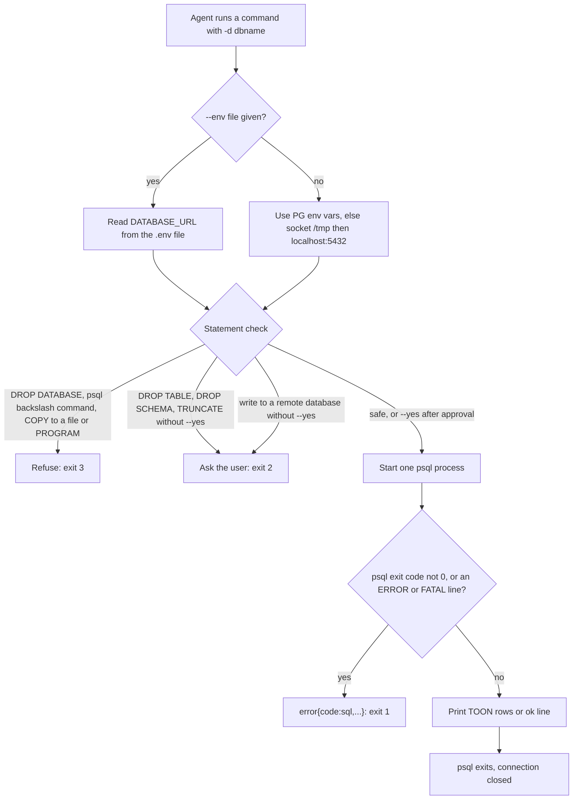

# postgres-irfan-axi

A small bash command line tool and a Claude Code skill that let an AI agent use a LOCAL postgres database.
It lists databases and tables, describes a table, runs read-only queries, runs DDL and DML, runs `.sql` files and creates databases.
It prints short TOON text instead of psql tables.
It refuses `DROP DATABASE`, psql backslash commands (`\!` shell, `\o`, `\copy`, `\i`, ...) and server-side `COPY` to a file or `PROGRAM`.
It asks for approval before `DROP TABLE`, `DROP SCHEMA` or `TRUNCATE`.

## Why it exists

Agents need a test database all the time: create tables, seed rows, check what a migration did.
Raw `psql` gives them too much rope and too much output:

- A long-lived connection or a database MCP server stays open and holds memory.
- One wrong statement can drop a real database.
- psql can print an `ERROR` and still look like it worked when the agent only reads part of the output.
- Big result tables waste the agent's context.

postgres-irfan-axi starts one `psql` process per call. The process exits, so the connection closes. Nothing stays open.
It refuses destructive statements, fails loudly on any SQL error, and caps output at 20 rows by default.

## How it works



## Requirements

- bash 4 or newer. The script starts with `#!/usr/bin/env bash`, so the first `bash` on your `PATH` must be bash 4+.
  macOS `/bin/bash` 3.2 cannot parse the script. On macOS install a newer bash (for example `brew install bash`) and put it first on `PATH`.
- A `psql` client. The tool uses `PGX_PSQL` if set, else the first one found of:
  `/opt/homebrew/opt/libpq/bin/psql`, `/opt/homebrew/bin/psql`, `/usr/local/bin/psql`, `psql` on `PATH`.
  On macOS: `brew install libpq`.
- A running postgres server. Default connection: unix socket in `/tmp`, then `localhost:5432`, user `postgres`.
- `/usr/bin/python3`, only for the `--env` flag (it parses the `.env` file and the URL). Any Python 3 at that path works.
- Standard tools: `awk`, `sed`, `grep`, `tr`, `paste`, `head`, `cut`.
- Optional: Claude Code, to use it as a skill.

## Install

Manual steps. There is no install script.

1. Clone the repo:
   ```sh
   git clone <this repo url> ~/code/ig-skills
   ```
2. Put the CLI on your PATH with a symlink. The self-test expects it at `~/bin/postgres-irfan-axi`:
   ```sh
   mkdir -p ~/bin
   ln -s ~/code/ig-skills/skills/postgres-irfan-axi/bin/postgres-irfan-axi ~/bin/postgres-irfan-axi
   chmod +x ~/code/ig-skills/skills/postgres-irfan-axi/bin/postgres-irfan-axi
   ```
   Make sure `~/bin` is on your `PATH`.
3. Give Claude Code the skill by linking the skill folder:
   ```sh
   ln -s ~/code/ig-skills/skills/postgres-irfan-axi ~/.claude/skills/postgres-irfan-axi
   ```
4. Optional environment variables (standard libpq names):
   ```sh
   export PGHOST=/tmp        # default: /tmp,localhost
   export PGPORT=5432
   export PGUSER=postgres
   export PGPASSWORD=<only if your server needs one>
   export PGX_PSQL=/path/to/psql   # pick a psql binary
   ```
5. Check it works:
   ```sh
   postgres-irfan-axi
   ```

## Usage

```sh
postgres-irfan-axi                              # server status + all databases (start here)
postgres-irfan-axi dbs                          # databases: name,size,conns
postgres-irfan-axi tables -d myapp_test         # tables: name,rows_est,size,indexes
postgres-irfan-axi desc users -d myapp_test     # columns + indexes + foreign keys
postgres-irfan-axi query "SELECT * FROM users" -d myapp_test            # one read-only statement, first 20 rows
postgres-irfan-axi query "SELECT * FROM users" -d myapp_test --limit 50
postgres-irfan-axi query "SELECT * FROM users" -d myapp_test --full     # all rows, no cell cut
postgres-irfan-axi exec "CREATE TABLE t(id int)" -d myapp_test
postgres-irfan-axi exec "DROP TABLE t" -d myapp_test --yes              # only after the user said yes
postgres-irfan-axi run schema.sql seed.sql -d myapp_test                # each file in one transaction
postgres-irfan-axi run concurrent-index.sql -d myapp_test --no-tx       # autocommit, for CREATE INDEX CONCURRENTLY
postgres-irfan-axi createdb myapp_test          # no-op if it exists
postgres-irfan-axi query "SELECT 1" --env ./.env                        # connect with the repo's DATABASE_URL
postgres-irfan-axi help                         # full reference
postgres-irfan-axi help query                   # one command
postgres-irfan-axi version
```

`--env <file>` reads `DATABASE_URL` (or the first `postgres://` URL) from the file. A local URL (`localhost`, `127.0.0.1`, `::1`) connects by socket first, then TCP with the URL's password. Any other host is "remote": `exec`, `run` and `createdb` there need `--yes`. The password goes to `PGPASSWORD`, never on the command line. `-d` defaults to the database in the URL.

`-d` takes a plain database name only (letters, digits, `_`, `$`, `-`). A URI or `key=value` connection string is refused (exit 4), because it could reach another host and skip the remote `--yes` check.

`query` runs exactly one statement in a read-only transaction: the server rejects writes and the tool says to use `exec`. Two statements, `DO` and `CALL` are refused (exit 4), because they can turn read-only off.

Output shape:

- Lists: `key[N]{fields}:` then indented rows. `key[0]: none` means a real empty result.
- Success: `ok{...}`. `run` adds the psql command tags as row-count proof, for example `tags:"INSERT 0 3;UPDATE 1"`.
- Error: `error{code,msg}`. SQL errors include the `DETAIL` and `HINT` lines.
- `next:` lines suggest the next command.

Exit codes: `0` ok, `1` SQL or connection error, `2` needs user approval (`--yes`), `3` forbidden (`DROP DATABASE`, `dropdb`, psql backslash commands, `COPY` to a file or `PROGRAM`), `4` usage error (also SQL the guard cannot parse, such as an unterminated quote, and a bad `-d`).

## Tests

`check.sh` is one self-test. It needs a local postgres server and a user that may create databases.
It creates its own throwaway database `pgx_check_<pid>`, runs 63 checks, and drops only that database at the end (also when a check fails).

```sh
bash ~/code/ig-skills/skills/postgres-irfan-axi/check.sh   # prints "PASS: all checks" or "FAIL: <check>"
```

It calls the CLI at `~/bin/postgres-irfan-axi` and runs its own setup with `PGX_PSQL` or `/opt/homebrew/opt/libpq/bin/psql` over the `/tmp` socket.
It checks: row limit, comma quoting, mixed-case table names, SQL injection in names, SQL errors never print `ok`, `run` transaction and `--no-tx` behaviour, the drop guards (also with comments inside the keywords and `--` inside a string), psql backslash commands and `COPY PROGRAM` / `COPY TO` file (marker files prove nothing ran), `query` stays read-only, `-d` URI and conninfo refused, `--env` local and remote, and that no connection is left open.

## Limits and known gaps

- Error detection reads the output. A line that starts with `ERROR:` or `FATAL:` counts as an error. So a `query` or `exec` whose data row starts with `ERROR:` is reported as an SQL error (exit 1), even though the SQL worked.
- This is a tool for local development, not a security boundary. The guard reads the SQL text; it stops mistakes, not a hostile user. For real protection, connect as a database role that only has the rights it needs.
- The guard drops comments outside strings, then matches words. It also fires when the words are inside a string. It does not see SQL built at run time (for example `EXECUTE` in a `DO` block in `exec`). It assumes `standard_conforming_strings` is on (the postgres default).
- Any backslash outside a string, also inside a comment, counts as a psql command and is refused. Put backslashes inside string literals.
- `COPY ... FROM` a server file and functions such as `pg_read_file` are not blocked. They can read any server file the postgres server user can read.
- Server-side file-writing functions (`lo_export`, adminpack) still work, also inside a read-only `query`. The default `postgres` user is a superuser, so use a limited role.
- `COPY` passes only with `TO STDOUT` (or no `TO`). Any statement with the words `COPY` and `TO` or `PROGRAM`, also inside strings, is refused (for example `INSERT ... 'Copy to clipboard'`).
- `run` refuses a file that contains a NUL byte (exit 4). `exec` and `query` cannot get one: a shell argument ends at a NUL.
- `DELETE` or `UPDATE` without `WHERE` is not guarded.
- `createdb` names may only use letters, digits, `_` and `-`, and must start with a letter or `_`.
- `desc` takes plain names only: `table` or `schema.table`, letters, digits and `_`. Names with spaces or other characters are refused.
- Cells longer than 120 characters are cut unless you pass `--full`.
- Columns are split on the byte `0x1f`. A value that contains that byte breaks the row shape.
- "Local" in `--env` means `localhost`, `127.0.0.1` or `::1` only. A local server reached by another name is treated as remote.
- `run --no-tx` stops at the first error. Statements before it stay committed; the error lists them in `committed:`.

## Licence

MIT
