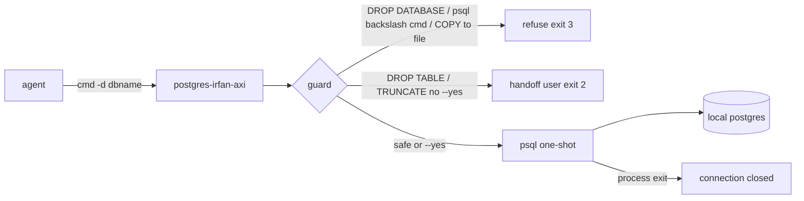

# postgres-irfan-axi

Agent bridge to local postgres. One psql process per call — process dies, connection dies. Zero lingering connections, RAM slim. Parallel-safe: run against 5 project dbs at once, no shared state.

Binary: `postgres-irfan-axi` (on PATH, for example `~/bin`). TOON output (~40% fewer tokens than JSON).



## Commands

```
postgres-irfan-axi                      server status + all dbs (start here)
postgres-irfan-axi dbs                  databases: name,size,conns
postgres-irfan-axi tables -d <db>       tables: name,rows_est,size,indexes
postgres-irfan-axi desc <t> -d <db>     columns + indexes + fkeys
postgres-irfan-axi query "<sql>" -d <db>  one read-only statement [--limit N] [--full]
postgres-irfan-axi exec "<sql>" -d <db>   DDL/DML write [--yes]
postgres-irfan-axi run f1.sql f2.sql -d <db>  scripts in order, each single-tx [--no-tx]
postgres-irfan-axi createdb <name>      create db, noop if exists
postgres-irfan-axi help [cmd]           reference
```

`-d <db>` always explicit — never guess which db, list with `dbs` first if unsure. Connection defaults local (socket /tmp, then localhost:5432; user postgres); `PGHOST/PGPORT/PGUSER/PGPASSWORD` override. In a repo, prefer `--env <repo>/.env`: uses its DATABASE_URL — local URL → socket, then TCP with the URL's password (scram); remote/staging URL → as given, and exec/run/createdb there need `--yes` after user approval.

## Hard rules

- **DROP DATABASE: never.** Tool refuses (exit 3), `dropdb` command refuses too. Do not work around via raw psql.
- **DROP TABLE / DROP SCHEMA / TRUNCATE: user approval first.** Tool exits 2 with `needs_approval`. STOP, hand off to user, state exactly what will be dropped. Only after explicit yes: re-run with `--yes`. Never pass `--yes` preemptively.
- **psql backslash commands (`\!`, `\o`, `\copy`, `\i`, `\gexec`...) and server-side `COPY` to a file or `PROGRAM`: refused** (exit 3). Plain SQL only.
- `query` = ONE statement, read-only (server rejects writes; no `DO`/`CALL`). Writes go through `exec` or `run`.
- `-d` = plain db name only. URI or `host=...` conninfo refused (exit 4).
- Guard is a text check for a local dev tool, not a security boundary. Real protection = a db role with limited rights.
- Query output capped at 20 rows by default. Footer says how many more. `--limit N` or `--full` only when you need them.
- Scripts run in single transaction per file — failed script rolls back whole file. `--no-tx` only for statements that cannot run in tx (CREATE INDEX CONCURRENTLY, VACUUM).

## Output contract

- TOON lists: `key[N]{fields}:` then indented rows. `key[0]: none` = definitive empty.
- Success: `ok{...}`. Error: `error{code,msg}` + exit code — 1 sql/conn, 2 needs approval, 3 forbidden, 4 usage.
- Failure = psql exit code != 0 or an ERROR/FATAL line. Never prints `ok` on a failed statement.
- `run` ok line carries psql command tags as row-count proof: `ok{cmd:run,...,tags:"INSERT 0 3;UPDATE 1"}` (last 20). RETURNING/SELECT/NOTICE output follows indented, max 20 lines.
- Long cells truncated `…+Nch` — `--full` to expand.
- `next:` lines suggest follow-up command.

## Typical test-setup flow

```
postgres-irfan-axi createdb myproj_test
postgres-irfan-axi run schema.sql seed.sql -d myproj_test
postgres-irfan-axi tables -d myproj_test
postgres-irfan-axi query "SELECT count(*) FROM users" -d myproj_test
```
