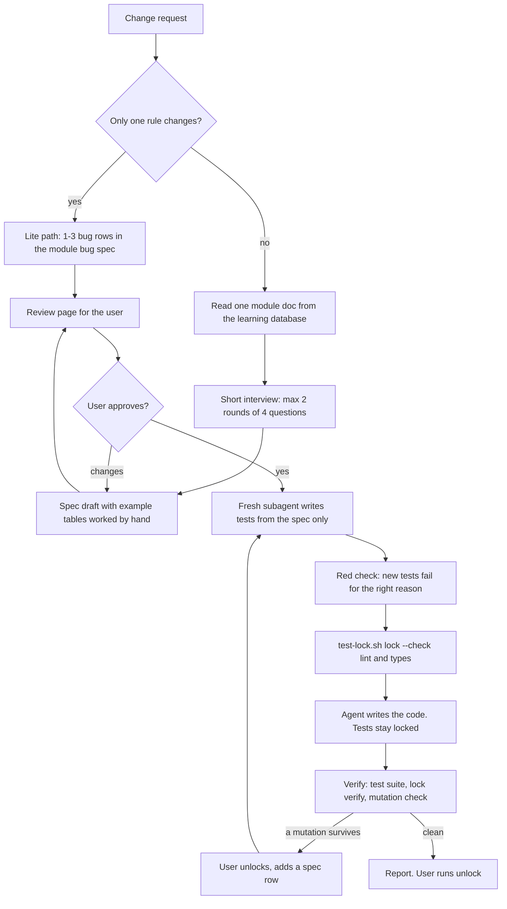

# test-engineer-irfan

A Claude Code skill for spec-first testing.
For any behaviour change it makes the agent write a short spec first, get it approved, write tests from the spec only, lock the tests, and only then write the code.
The pass or fail verdict comes from real command output, never from the agent's own notes.
It also has an end-to-end QA mode: test a doc or a diff against the running app with curl or a real browser, and save the evidence.

The skill is instructions (Markdown) plus one enforced piece: the [test-lock](../../tools/test-lock/README.md) hook.

## Why it exists

AI agents are bad at testing their own code in a few known ways:

- Tests written by reading the code copy the code's bugs. The expected value should come from the rule, not from the code.
- When a test fails, the agent edits, skips or weakens the test to get green.
- The agent writes "verified" with no command output behind it.
- Coverage looks high, but the tests would still pass if the code was broken.

This skill answers each one: expected values are worked out by hand in a spec, a fresh subagent writes the tests from the approved spec without reading the code, a hook locks the tests, and a mutation check proves the tests can fail.

## How it works



Files:

- `SKILL.md`: the main workflow (Phase 1 to 8, lite path, hard rules).
- `templates.md`: spec, bug spec, index line, review page, rule-to-test map, red check and report shapes.
- `e2e-qa.md`: the QA mode (test cases, plan approval, curl and browser execution, evidence report).
- `tests/test-lock-check.sh`: self-test for `test-lock.sh lock --check`.

## Requirements

Required:

- Claude Code (the skill uses the Skill tool, subagents and AskUserQuestion).
- [test-lock](../../tools/test-lock/README.md) at `~/.claude/hooks/test-lock.sh`, registered as a `PreToolUse` hook. Its requirements apply: bash 3.2+, git 2.31+, `jq`, `shasum`.
- The [learning](../learning/README.md) skill at `~/.claude/skills/learning`. Specs live in `<repo>/.learning/specs/` and the skill calls `learn.sh find` and `learn.sh build`.
- Node.js with `npm`, for the review page tool `lavish-axi` (run with `npm exec --yes --package=lavish-axi@0.1.90 -- lavish-axi ...`, so no global install).
- The top-level version is pinned; its dependencies still resolve by range. Bump the pin on purpose, after you check the new release.

Optional (used when the project has them, or when you say yes to installing):

- A test runner in your project. The text assumes Vitest or Jest for unit and integration tests and Playwright for browser e2e.
- `fast-check` for property tests, `@stryker-mutator` for mutation tests. The skill asks before installing either.
- [postgres-irfan-axi](../postgres-irfan-axi/README.md) for integration tests against a real local database.
- `curl` and `newman` for backend QA.
- The `chrome-devtools-axi` skill, or the Claude in Chrome tools, for browser QA.
- The `oh-my-claudecode` plugin, for the `oh-my-claudecode:test-engineer` subagent type. Any fresh subagent works.
- `python3` with `openpyxl`, only when the QA input is an `.xlsx` file.
- `jobq` (see `tools/jobq`) when your project queues heavy commands like lint and typecheck.

## Install

Manual steps. There is no install script.

1. Clone the repo:
   ```sh
   git clone <this repo url> ~/code/irfan-skills
   ```
2. Install test-lock and register its hook. Follow [tools/test-lock/README.md](../../tools/test-lock/README.md).
3. Install the learning skill. Follow [skills/learning/README.md](../learning/README.md).
4. Give Claude Code this skill by linking the skill folder:
   ```sh
   ln -s ~/code/irfan-skills/skills/test-engineer-irfan ~/.claude/skills/test-engineer-irfan
   ```
5. Restart Claude Code.

## Usage

In Claude Code:

```text
/test-engineer-irfan add a late fee to invoices      # full path, Phase 1 to 8
/test-engineer-irfan fix: refund rounds down          # one-rule bugfix, lite path
/test-engineer-irfan full path ...                    # force the full path
qa this docs/feature-x.md                             # QA mode against the running app
e2e test my changes                                   # QA mode on the current git diff
```

What you do as the user:

1. Answer the interview questions (max 2 rounds).
2. Read the review page and approve the spec, or ask for changes. No test code is written before you approve.
3. When the agent says a test looks wrong, decide. Only you can unlock.
4. When you are happy with the report, unlock in your own terminal:
   ```sh
   bash ~/.claude/hooks/test-lock.sh unlock
   ```

QA mode always shows you the test plan first and runs nothing before you approve it.
On a remote or staging target it only reads data. It never targets production.

## Tests

```sh
PATH=/bin:/usr/bin:/opt/homebrew/bin bash ~/code/irfan-skills/skills/test-engineer-irfan/tests/test-lock-check.sh
# PASS: 6 cases (a, b, b2, c, d, e)
```

It tests `~/.claude/hooks/test-lock.sh` by default. Set `TL=<path to test-lock.sh>` to test another copy.
It runs in a temp git repo with `HOME` set to a temp folder. The `PATH` above makes it run under macOS `/bin/bash` 3.2.

The Markdown workflow itself has no automated test.

## Limits and known gaps

- Only the test lock is enforced by code. Everything else (spec first, approval gate, "never read the implementation", red check) is instructions the model follows. It can still drift; the user's review is the real gate.
- test-lock patterns are for JavaScript and TypeScript test files (`*.spec.ts`, `*.test.tsx`, ...). Other languages need an edit in `test-lock.sh`.
- While the lock is on, the agent cannot add a new test file either. A new rule means: unlock, add the spec row, write the test, lock again.
- The lazy context step reads one module doc. If the learning database is missing or stale, the spec has less context.
- The review page needs `lavish-axi` through `npm exec`; on some setups `npx -y lavish-axi` fails.
- Browser QA needs a headed browser the agent can drive. Without one, browser cases are BLOCKED, never faked.
- The mutation check is only asked for critical code (payment, auth, money). Manual mutation is 3 to 5 changes, not a full mutation run.

## Licence

MIT
