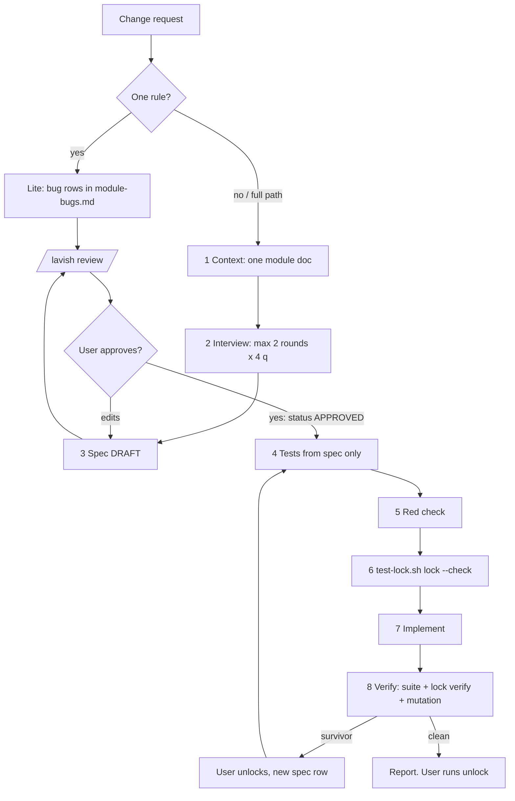

# test-engineer-irfan

Spec owns expected values. Tests come first, then get locked. Verdict comes from command output only.

## Why
- Tests made from code copy the code's bugs. Spec owns expected values, never the implementation.
- Tests written before the code give more correct code.
- Agents edit, skip, or weaken tests to get green. So tests are locked by a hook, not by a promise.
- Agent "verified ✓" notes and screenshots are evidence, not the verdict. Pass/fail only from real command output.
- Test strength = mutation (break the code on purpose: do tests fail?), not coverage %.

## Pick path
- Change is one rule (one-rule bugfix) → **lite path** (bottom). Say "lite path" in first reply. The user says "full path" → full.
- Else → full path, Phase 1-8.
- QA a doc or diff against a running app, no code change planned → `e2e-qa.md` only.

## Phase 1 — Context (lazy)
1. `bash ~/.claude/skills/learning/bin/learn.sh find <module> <feature terms>`. Open ONLY `.learning/modules/<module>.md`.
2. Module doc missing → `/learning module <module>`, that module only. No `.learning/` at all → write `.learning/.gitignore` (`*`) first. Never `/learning onboard`, never full-repo scan, never `cat .learning/*` from this skill.
3. Read the module doc `## Specs` index. Feature has a line → open only that spec. Never open other features' specs. Never backfill specs for untouched or legacy features.

## Phase 2 — Interview (max 2 rounds, max 4 questions per round, AskUserQuestion)
- Ask only what the module doc and current spec do not answer. Facts (code, files, tools) → look up, never ask.
- Each question: likely answers as options, recommended first with "(Recommended)".
- Cover: business rules · boundaries (min/max, rounding, empty, limits) · error and invalid cases · existing behaviour that must not change · FE: UI states (loading, empty, error, success).
- Backward compat comes from (a) existing tests, which always run, and (b) B-items in this spec. Never read other features' specs for it.

## Phase 3 — Spec draft → /lavish → STOP
1. Write `.learning/specs/<module>/<module>-<feature>.md` from `templates.md` §Spec. id = filename stem (learning contract: unique across modules). `status: DRAFT`.
2. Layer per rule (Testing Trophy):

   | Rule kind | Layer |
   |---|---|
   | pure logic | unit |
   | ranges, money, rounding, invariants, idempotency, state transitions | property (fast-check) + 2-3 unit examples |
   | touches DB, queue, other service | integration, real DB (`postgres-irfan-axi`), never Prisma mocks |
   | critical user flow | one Playwright e2e |
   | types, shape | static (`tsc --strict`, lint), no test |

3. Example tables: work out every expected value by hand from the rule. Never from running or reading code. Money/rounding → show the arithmetic in `note`.
4. Add/update the feature line in the module doc `## Specs` (`templates.md` §Index). Only other module-doc change allowed: new learnings. Run `learn.sh build` → zero `problem:` lines.
5. Load `/lavish` (Skill tool) and follow its CLI guidance. Build the review page per `templates.md` §Lavish: verdict line first · interview Q&A with picked answers · rules and old behaviours to keep, with example tables · layer + one-line why · planned tests (rule, test name, layer, file) · out of scope · open questions and assumptions. Labels in words with a short name ("Rule 1 — fee rounds up"), never bare R1/B1.
6. **STOP.** Wait for the user. Edits → apply to the spec .md (source of truth). Big edits → re-run /lavish. Explicit approval → set `status: APPROVED`. No test code before that.

## Phase 4 — Tests from spec only
- Delegate to ONE fresh subagent (`oh-my-claudecode:test-engineer`, handover states objective, hard rules, inputs, definition of done, output format). Inputs: APPROVED spec path, interface/DTO/signature files, test conventions, existing test helpers. Hard rule in handover: never open implementation files of the feature under test. Why: main thread may have seen code. Fresh context stops it leaking into expected values.
- Every test name starts with its rule id: `R3: fee rounds up to whole cent`, `B1: ...`, `BUG2: ...`.
- Property tests: fast-check. Not in `package.json` → AskUserQuestion before install. No → extra boundary unit cases instead (min, min-1, max, max+1, zero, rounding edge).
- FE e2e (Next.js): Playwright, `getByTestId` asserts on spec values + `toHaveScreenshot` against baselines. Agent screenshots = optional evidence only.
- Integration: real DB, real module wiring. Mock only third-party network.
- Slop review on every new test: reject a test that passes with the code body deleted, asserts only a mock call, has no real assertion, or copies its expected value from code output.
- Coverage map (`templates.md` §Map): every R and B has ≥ 1 test, every test maps to one rule. Gap or orphan → fix before Phase 5.

## Phase 5 — Red check
- Run only the new tests. Quote runner output.
- R tests must FAIL for the expected reason: assertion mismatch or not-implemented. Import, syntax, or setup error = not red → fix setup.
- B tests must PASS.
- R test already passes → rule may already hold or test is weak. Tell the user, do not go on silently.
- Report `templates.md` §Red. Fix only setup (imports, fixtures, config). Never touch expected values or assertions.

## Phase 6 — Lock
1. From repo root: `bash ~/.claude/hooks/test-lock.sh lock --check "<eslint on new test files> && <typecheck>"`. Hashes test files, snapshot baselines and `.learning/specs/**` into `.claude/test-lock.json` (local only, added to `.git/info/exclude`). Check fails → lock NOT written: fix lint/types, lock again. Project queues heavy commands (e.g. `jobq`)? Use it inside the check: `--check "jobq npx eslint <files> && jobq npx tsc --noEmit -p <tsconfig>"`. Heavy check → run the lock call with the Bash tool's `run_in_background` (tool timeout kills long runs). Never lock without `--check`.
2. While locked, the PreToolUse hook blocks: Edit/Write on locked files, `test-lock.sh unlock`, any touch of the lock file or script, snapshot updates (`-u`, `--update`, `--update-snapshots`, `--updateSnapshot`).
3. `lock` refuses when a lock already exists. Only the user runs `unlock`, from their own terminal.

## Phase 7 — Implement
- Tests stay locked. A test looks wrong → STOP, tell the user which rule, in words ("Rule 3 — fee rounds up"), and why. Never work around it: no sed on tests, no skip, no new looser test, no snapshot update.
- Work bigger than one bounded session → split by rule, one rule group per session. Ask the user before the split; name each group in words.
- Pre-existing test fails → bug in the change. Fix the code, never edit the old test.

## Phase 8 — Verify (command output only, nothing self-reported)
1. Run the full relevant suite for the touched module: unit + integration + e2e. Quote exact pass/fail counts from runner output. No output = did not run.
2. `bash ~/.claude/hooks/test-lock.sh verify`. Any changed/added/removed file → run FAILS.
3. Mutation check, critical modules only (payment, auth, money):
   - Stryker installed (`npx stryker --version`) → run scoped: `npx stryker run --mutate <touched files>`.
   - Not installed → AskUserQuestion before install. No → manual: `cp <file> <scratchpad>/<name>.bak`. Apply 3-5 mutations one at a time (flip `>`/`>=`, `ceil`/`floor`, change a constant, remove a branch). Run tests after each, record killed/survived. Restore from backup, then `git diff --quiet <file>` proves restore.
   - Survivor → the user unlocks (tests and specs are locked) → new spec row, the user approves → test → red check → `lock` again.
4. Final report (`templates.md` §Report): rule → test table, suite counts (quoted), lock verify output, mutation survivors. Screenshots attached as evidence only.
5. Behaviour change on a running app → E2E evidence pass per `e2e-qa.md`.
6. Update the module doc: `## Specs` line + new learnings. Tell the user: "run `bash ~/.claude/hooks/test-lock.sh unlock` when satisfied."

## Lite path (one-rule bugfix)
1. Phase 1 context, same lazy rules. Skip the interview.
2. Add 1-3 rows to `.learning/specs/<module>/<module>-bugs.md` (create from `templates.md` §Bugs). Expected values by hand. `status: DRAFT` per row.
3. Short /lavish: Verdict line + the bug rows + reproduction test plan only. STOP for approval → rows `status: APPROVED`.
4. Write a failing reproduction test (`BUG<n>: ...`). Red check: fails for the right reason.
5. `lock --check "..."` (Phase 6) → fix → Phase 8 steps 1-2 only.

## Hard rules
- Expected values come from the spec, worked by hand. Never from running or reading code.
- Never edit, skip, or weaken tests while `.claude/test-lock.json` exists. Stop and report.
- Pass/fail claims quote command output. "verified" notes and screenshots are not proof.
- Never run `test-lock.sh unlock`. Never update snapshot baselines.
- Specs on demand only: never preload, never read all, never backfill.
- Subagents: keep parallel lanes few (for example max 4). Every handover repeats these hard rules + the project's security and performance rules.
