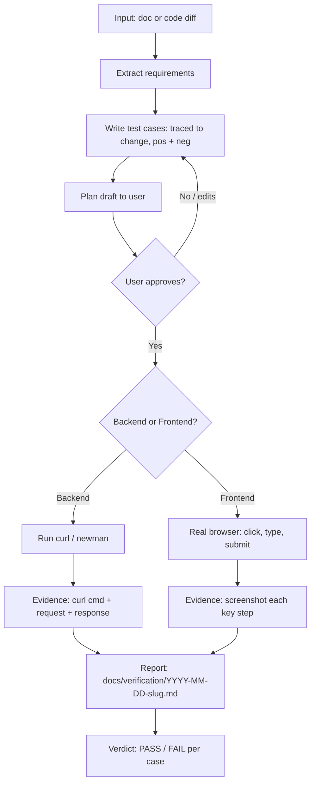

# test-engineer-irfan — E2E QA mode

Used by SKILL.md: Phase 8 evidence pass, and "qa this doc / e2e test my changes" with no code change planned.

## Flow



## Phase 1 — Ingest input

Input is one of:

| Input | How to read |
|---|---|
| `.md` / `.txt` | Read tool direct |
| `.csv` | Read direct; each row = candidate test case if it looks tabular spec |
| `.xlsx` | `python3 -c "import openpyxl"` check; if missing `pip install openpyxl` in scratchpad venv, dump sheets to csv, then read. Fallback: `python3` + pandas |
| code changes | `git diff` / `git diff main...HEAD` / PR diff via gh-axi. List each changed behaviour with its `file:line`, plus which endpoints/pages it touches. Untouched code is out of scope |
| postman collection `.json` | Parse requests; these become the backend suite base |

Extract: every requirement, rule, field, boundary, error condition mentioned. Ambiguous requirement → note assumption in report, still test the sane interpretation. Subagents never ask user; main thread MAY ask if requirement contradicts itself.

## Phase 2 — Write test cases

Each case, this exact shape:

```
### Test <n>: <short name>
- Type: backend | frontend | mixed
- Kind: positive | negative
- Source: <changed file:line, or the doc row it proves, in words>
- Needs first: <state needed before step 1>
- Steps: <numbered, concrete — real URL, real payload, real button label>
- Expect: <observable outcome — status code, body field, UI text, redirect>
```

Rules:
- ALWAYS E2E. Test through the real surface (HTTP endpoint, real browser page). Unit tests are NOT this skill's job.
- **Testing Trophy:** E2E is the top, thinnest layer — critical paths of the change only. Static, integration, and unit checks live elsewhere; do not re-test them here.
- **Quality over quantity.** Write the fewest cases that prove the change is safe. 3-5 cases is often enough. No hard cap: add a case only for another distinct changed behaviour, never to pad coverage.
- **Scoped to the change.** Every case has a `Source:` — the changed `file:line` or the doc row it proves. No source = delete the case. No edge-case hunting in code the change did not touch.
- **Positive + negative.** Every changed behaviour gets at least one positive case (works as intended) and at least one negative case (bad input, unauthorized, wrong state is rejected correctly).
- Security and API checks (IDOR on resource-by-id, pagination on list endpoints, error format) only where the change touches that surface.
- Doc input: rows/requirements map 1:1 to cases — no invented features, no skipped rows, no extras. If row untestable (no app, missing env), mark BLOCKED with reason, do not drop it.

Slop filter — before Phase 3, drop or rewrite any case that:
- has no `Source:` tracing to the change or a doc row
- tests a path the change did not touch
- duplicates another case with new inputs but no new behaviour
- expects only "no error" instead of an observable outcome

## Phase 3 — Plan draft + user approval (MANDATORY GATE)

Before running ANYTHING: present plan draft to user. Draft = the test cases from Phase 2 + target env + what data will be created/changed + tools used (curl/newman/browser). Use AskUserQuestion if available (approve / edit / cancel), else prose.

Rules:
- NEVER execute before explicit approval. No "I'll start while you read".
- After approval: run EXACTLY the approved plan. No extra cases, no extra endpoints, no scope creep. New case idea mid-run → STOP and ask user (AskUserQuestion) before running it. Declined, or running as subagent (cannot ask) → note in report under Findings as "suggested, not run", do not execute.
- User edits plan → update draft, re-present, wait again.

## Phase 4 — Execute

### Env + data rules (HARD)

- Default target: **local** (localhost app + local Postgres). Local = free rein: seed, insert, update, delete test data as needed to exercise API/frontend. Local Postgres via the `postgres-irfan-axi` skill/CLI — localhost only. Test needs direct db change (create/alter table, seed data, inspect rows, run .sql script)? Use `postgres-irfan-axi` commands (`createdb`, `run`, `exec`, `query` with `-d <db>`), not raw psql. Its guards still apply: DROP DATABASE never; DROP TABLE/TRUNCATE only after user approval + `--yes`.
- **Staging/remote env: READ-ONLY on data.** No INSERT/UPDATE/DELETE, no seeding, no mutating endpoints that change real records (POST/PUT/PATCH/DELETE against staging data = forbidden unless user explicitly approved that exact call in the plan). Data changes ONLY on local connection.
- Unsure if connection is local? Check host: not `localhost`/`127.0.0.1` = treat as staging = read-only.
- Production: never target. Full stop.

App must be RUNNING. Not running → try to start it (`/run` skill or project scripts). Cannot start → all cases BLOCKED, report blocker, stop. Never fake execution.

### Backend

Preference order:
1. **curl** — default, easiest to show evidence.
2. **newman** — when postman collection exists: `npx newman run collection.json -e env.json --reporters cli,json --reporter-json-export newman-result.json`.

Every request capture: exact curl command, request body, full response (status + headers that matter + body). Use `-s -w '\nHTTP %{http_code}\n'`. Localhost only unless user gave real target. Secrets from env, never hardcoded into evidence — redact tokens in report (`Bearer <redacted>`).

### Frontend

Preference order (headed, real input events — project rules may name the Chrome profile):
1. **chrome-devtools-axi skill** — default (token-cheap). Attach to the user's running Chrome when the project names a profile.
2. **claude-in-chrome MCP tools** — fallback when axi cannot attach, errors, or a `click` changes nothing twice (fresh snapshot shows no change). Note per step which driver ran it.
3. Both fail → BLOCKED (tooling). Headless never counts as visual evidence.

Act like human QA: navigate page, click the actual button, type into the actual field, submit, observe. NOT just checking DOM exists. Screenshot at each key step: initial state, after input, after action, final/error state. Save to `docs/verification/screenshots/<YYYY-MM-DD>-<slug>-<step>.png`. Console errors during flow = finding, include in report.

**Responsive + design match.** Every changed screen at the project's widths (project rules name them, e.g. desktop / tablet / mobile; none named → desktop + mobile), one screenshot per width. Design frame known (Figma) → render it to disk, compare per width, each delta (spacing, type, colour, radius, missing state) = finding with the screenshot pair. No frame → still check no horizontal scroll, no clipped or overlapping text.

**No cheating (HARD):**
- State changes only through the UI like a user. Never `eval`/JS to click, set values, remove `disabled`, close dialogs, or edit DOM/CSS/storage mid-flow. JS is read-only (layout, computed style, overflow, toast text).
- Setup data/login shortcuts only before step 1 and listed in `Needs first:`. The thing under test (e.g. login) always runs the real path.
- Each step's result comes from a fresh snapshot/screenshot after the action, never from the action's return value.
- Workaround needed → step = NOT PROVEN, not PASS. Retries stated with count. Never edit `Expect:` to match what happened.
- Screenshot is evidence only when the file is a real image (> 200 bytes) and you looked at it.

### Mixed

Frontend action then verify backend effect via curl (or vice versa). Both evidence types required.

## Phase 5 — Evidence + report

Write `docs/verification/<YYYY-MM-DD>-<slug>.md`. Caveman style, normal level (not ultra) — easy English, short words, fragments OK, zero fluff, no bare codes. MUST contain mermaid diagram of tested flow (sequence diagram for API chains, flowchart for UI paths).

Report skeleton:

```markdown
# QA run · <slug> · <date>

**Verdict:** PASS | FAIL (<n> of <m> tests failed) | BLOCKED — <one plain sentence>

## Flow tested
<mermaid diagram — the actual path taken>

## Tests

### Test 1: <name> — PASS|FAIL|BLOCKED
**Sent:**
\```bash
curl -s -X POST http://localhost:3000/api/login \
  -H 'Content-Type: application/json' \
  -d '{"email":"a@b.c","password":"x"}' \
  -w '\nHTTP %{http_code}\n'
\```
**Got:**
\```json
{"token":"<redacted>"} 
HTTP 200
\```
**Expect:** 200 + token. **Result:** PASS.

### Test 2: <name> — PASS
Steps: 1. open /login 2. type email 3. click "Sign in" 4. see dashboard
Evidence:  

## Summary
| Test | Name | Type | Result |
|---|---|---|---|
| 1 | login ok | backend | PASS |
| 2 | login ui | frontend | PASS |
| 3 | bad password | backend | FAIL — got 500, expect 401 |

## Findings
- <bug or assumption, one line each>
```

Hard rules:
- No evidence = case did not run. Never write PASS without captured response/screenshot.
- Nothing runs without approved plan. Executed set must match approved set exactly.
- FAIL is a valid outcome — report it honestly, do not "fix" the test to green.
- Result per case: PASS | FAIL | NOT PROVEN (needed a workaround) | BLOCKED (could not run).
- Report starts with the **Verdict:** line, right under the title.

## Delegation

Big suite (>10 cases) → split backend/frontend lanes to parallel subagents (`oh-my-claudecode:executor` or direct). **Max 3 subagents in parallel**; more lanes → run in batches. Each handover repeats: E2E only, evidence mandatory, cases scoped to the change, redact secrets, report format above, approved plan only (no scope creep), env+data rules (mutate data local only, staging read-only). Main thread merges into one report.
