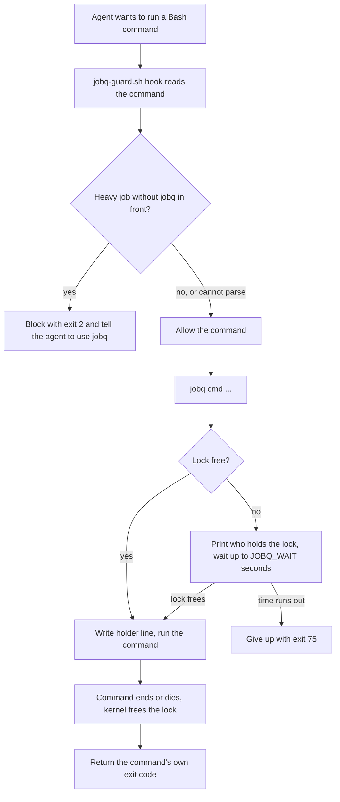

# jobq

A machine-wide queue that runs one heavy job at a time (test runs, type checks, lint, builds).
It comes with a Claude Code `PreToolUse` hook that blocks heavy commands unless they start with `jobq`.
Other sessions wait their turn instead of all running at once.

## Why it exists

On a laptop with little RAM, several AI agent sessions often start `vitest`, `tsc` or `next build` at the same time.
The machine runs out of memory, everything slows down, and jobs crash or time out.
jobq makes those jobs line up. The hook makes sure agents cannot forget to use it.

## How it works



The lock is a file lock taken with `lockf`. The kernel drops it when the job exits or crashes, so a dead job never leaves a stuck lock.
A `jobq` call inside a job that already holds the lock runs at once, so nested calls do not wait on themselves.

## Requirements

- macOS. `jobq` uses the BSD `lockf` command (`lockf -k -s -t`). Linux `lockf`/`flock` take different flags and will not work as is.
- bash 3.2 or newer (the macOS system bash is fine).
- `ps`, `id`, `awk`, `tr`, `grep` (all present on macOS).
- `jq` for the hook (`jobq-guard.sh`) and the self-test.
- `perl` with `Time::HiRes` for the self-test only (present on macOS).
- Environment variables, all optional:
  - `JOBQ_DIR`: lock folder. Default `/tmp/jobq-<your uid>`. Must be a folder you own and not a symlink. It is set to mode 700.
  - `JOBQ_WAIT`: how many seconds to wait for the lock. Default `3600`.
  - `CLAUDE_CODE_SESSION_ID`: if set, its first 8 characters go into the holder line so you can see which session holds the lock.

## Install

Manual steps. There is no install script.

1. Clone the repo:
   ```sh
   git clone <this repo url> ~/code/irfan-skills
   ```
2. Link the folder to where Claude Code tools live, and put `jobq` on your PATH:
   ```sh
   mkdir -p ~/.claude/tools ~/.local/bin
   ln -s ~/code/irfan-skills/tools/jobq ~/.claude/tools/jobq
   ln -s ~/.claude/tools/jobq/jobq ~/.local/bin/jobq
   chmod +x ~/code/irfan-skills/tools/jobq/jobq ~/code/irfan-skills/tools/jobq/jobq-guard.sh
   ```
   Make sure `~/.local/bin` is on your `PATH`. The scripts find their own folder, so they work through symlinks.
3. Register the hook in a Claude Code settings file (`~/.claude/settings.json` for all projects, or `.claude/settings.local.json` in one project). Use the full path to your home folder in place of `<home>`:
   ```json
   {
     "hooks": {
       "PreToolUse": [
         {
           "matcher": "Bash",
           "hooks": [
             { "type": "command", "command": "bash <home>/.claude/tools/jobq/jobq-guard.sh", "timeout": 10 }
           ]
         }
       ]
     }
   }
   ```
   If the file already has a `hooks.PreToolUse` list, add this entry to it.
4. Restart Claude Code so it loads the hook.

Tell your agents to run `jobq` commands with the Bash tool's `run_in_background` option. A queued wait can last longer than the Bash tool timeout, which would kill the job before it starts.

## Usage

```sh
jobq npx vitest run src/users          # run a test file through the queue
jobq npm run build                     # run a build through the queue
jobq npx tsc --noEmit
jobq status                            # "idle", or the holder line: time pid sid cwd cmd
JOBQ_WAIT=60 jobq npx eslint src/a.ts  # wait at most 60 s for the lock
```

When the lock is busy, jobq prints `jobq: queued behind <holder line>` on stderr and waits.

Exit codes:

- The command's own exit code when it ran (including 75 if the command itself returned 75).
- `64`: no command given.
- `70`: `JOBQ_DIR` is not a folder you own, or is a symlink.
- `75`: waited `JOBQ_WAIT` seconds and gave up (`jobq: gave up after ...` on stderr).

What the hook treats as heavy (blocked unless started with `jobq`):

- `vitest`, `tsc`, `eslint` in any form (`npx`, `node ./node_modules/...`, `./node_modules/.bin/...`).
- `next build`, `nest build`, `playwright test`.
- `npm test`, `npm t`, `npm run build|test|lint|lint:ci|typecheck`, `npm run test:<anything>`, and `npm exec` / `npm x` of a heavy tool.
- These also when wrapped in launchers (`timeout`, `nice`, `env`, `sudo`, `xargs`, `caffeinate`, ...), in `bash -c` / `sh -c` / `eval` bodies, or in a heredoc fed to a shell.

Not blocked: text that only mentions these words (`grep`, `echo`, commit messages, heredocs written to a file), `npm run dev`, `npx next dev`, `command -v tsc`, and `npm run test:smoke*`.

## Tests

The self-test uses its own temporary lock folder (`JOBQ_DIR=$(mktemp -d)`), so it does not touch the real lock or block other sessions.

```sh
bash tools/jobq/test.sh   # prints one "ok" or "FAIL" line per check, then ALL PASS or FAILED
```

It checks the hook allow/deny table, hook speed on 300 KB commands, the queue race, nested calls, pid reuse, exit code pass-through, wait timeout, and lock folder ownership. It takes about 20 seconds.

## Limits and known gaps

- macOS only (BSD `lockf`, and `stat -f` in the test).
- One global lock for every heavy job on the machine. Two small jobs still wait for each other.
- The hook only sees commands sent through Claude Code's Bash tool. Other terminals and tools are not checked.
- The hook reads the command text. A heavy tool hidden inside a script file (`bash scripts/build.sh`) is not detected.
- If the hook cannot parse the input, it allows the command (fails open on purpose).
- `npm run test:smoke*` is allowed by a fixed rule in the hook. Edit `jobq-guard.sh` to change the list of heavy commands.
- The holder line shows the full command and working folder. It is stored with mode 600 in a mode 700 folder.

## Licence

MIT
