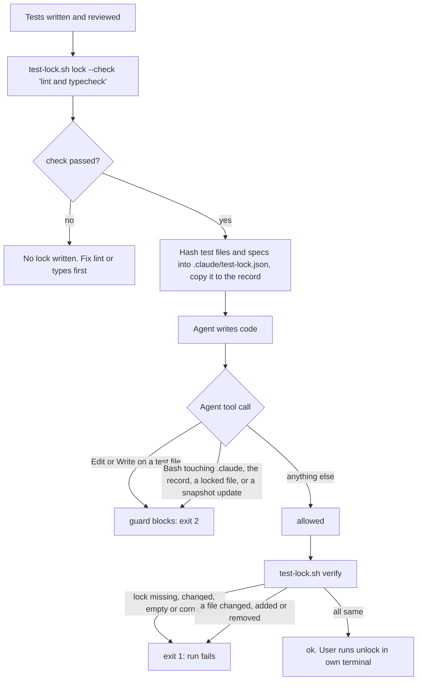

# test-lock

A small bash script that locks test files with sha256 hashes, plus a Claude Code hook that stops an agent from changing them.
Use it when tests are written first and the agent then writes the code: the agent must make the code pass the tests, not change the tests.

## Why it exists

An AI agent that cannot get a test green will often edit the test instead: loosen an assertion, skip a case, or update a snapshot.
Asking it nicely not to do that does not work every time.
test-lock turns the rule into a check:

- `lock` records a hash of every test file, snapshot baseline and spec file, and keeps a copy (the record) outside the repo.
- The `guard` hook blocks the usual ways an agent changes those files or removes the lock while it exists.
- `verify` proves nothing changed, so a gate can fail the run if something did. `verify` is the real gate; the guard only makes cheating harder.

Only the user removes the lock, from their own terminal.

## How it works



What counts as a locked file (any depth, so monorepos work):

- `*.spec.ts`, `*.spec.tsx`, `*.test.ts`, `*.test.tsx`, `*.e2e-spec.ts`
- anything under an `e2e/` folder, a `*-snapshots/` folder or a `__snapshots__/` folder
- `*.md` files under `.learning/specs/` in the main checkout (also when you run from a linked git worktree)

Test files are found with `git ls-files -co --exclude-standard` (tracked and untracked, not ignored).
The lock file `.claude/test-lock.json` is added to `.git/info/exclude`, so it never gets committed.

The record is a byte copy of the lock at `${XDG_STATE_HOME:-$HOME/.local/state}/test-lock/<sha256 of the repo root path>.json` (folder mode 700). Each checkout, linked worktrees too, has its own record. It lets `verify` notice a lock that was deleted, replaced or edited.

## Requirements

- bash 3.2 or newer. Tested with macOS `/bin/bash` 3.2 and bash 5.
- git 2.31 or newer (uses `git rev-parse --path-format=absolute`).
- `jq`.
- `shasum` (ships with macOS; on Linux it comes with perl).
- `cmp` (part of the base system on macOS and Linux).
- Claude Code, for the `guard` hook.
- Must run inside a git repository.

## Install

Manual steps. There is no install script.

1. Clone the repo:
   ```sh
   git clone <this repo url> ~/code/irfan-skills
   ```
2. Link the script to where the hook will call it:
   ```sh
   mkdir -p ~/.claude/hooks
   ln -s ~/code/irfan-skills/tools/test-lock/test-lock.sh ~/.claude/hooks/test-lock.sh
   chmod +x ~/code/irfan-skills/tools/test-lock/test-lock.sh
   ```
3. Register the guard in a Claude Code settings file (`~/.claude/settings.json` for all projects). Use the full path to your home folder in place of `<home>`:
   ```json
   {
     "hooks": {
       "PreToolUse": [
         {
           "matcher": "Edit|Write|MultiEdit|Bash",
           "hooks": [
             { "type": "command", "command": "bash <home>/.claude/hooks/test-lock.sh guard" }
           ]
         }
       ]
     }
   }
   ```
   If the file already has a `hooks.PreToolUse` list, add this entry to it.
4. Restart Claude Code so it loads the hook.

In a repo with no `.claude/test-lock.json` the guard only blocks calls that touch the record folder or change `HOME` next to `test-lock` (see below), so it is safe to register it for every project.

## Usage

Run these from anywhere inside the repo. The script finds the repo root itself.

```sh
bash ~/.claude/hooks/test-lock.sh lock --check "npx eslint src/a.test.ts && npx tsc --noEmit"
bash ~/.claude/hooks/test-lock.sh lock      # works, but prints a notice: lint/typecheck not verified
bash ~/.claude/hooks/test-lock.sh verify    # "ok: N locked files unchanged", or one line per change
bash ~/.claude/hooks/test-lock.sh unlock    # the user only, in their own terminal
```

- `lock --check "<cmd>"` runs `<cmd>` with `bash -c` from the repo root first. If it fails, no lock is written and the last 20 lines of its output are shown.
- `lock` refuses when a lock or a record for this repo already exists: `The user must unlock first.` So deleting the lock and locking again does not work.
- `lock` refuses when there is nothing to lock (no test, snapshot or spec file).
- `verify` fails (exit 1) when:
  - the lock has no record (record deleted, or lock made by an older test-lock): `no record for this lock … the user must unlock and lock again.`
  - a record exists but the lock file is gone, or differs from the record,
  - the lock is empty, not valid JSON, or has no files,
  - any locked file is `changed: <path>`, `added: <path>` or `removed: <path>` (one line each).
- `unlock` deletes the lock and its record.
- `guard` is the hook mode. It reads the hook JSON on stdin.

What the guard blocks while a lock exists in the repo (found from the working folder or a `cd <dir>` in the command):

- `Edit`, `Write` and `MultiEdit` on a locked file, on the lock file itself, or on `test-lock.sh`.
- A Bash command that names `test-lock` followed by `.`, `*`, `?` or `[` (so `test-lock.sh`, `test-lock.json`, `test-lock.*`), except `test-lock.sh verify` and `test-lock.sh lock`. So the agent cannot run `unlock`.
- A Bash command that mentions `.claude` and has a write verb (`rm`, `mv`, `cp`, `ln`, `unlink`, `truncate`, `dd`, `install`, `touch`, `chmod`, `shred`, `rsync`, `patch`, `sed -i`, `perl -i`, `find -delete`, `git clean|checkout|restore|stash|reset|mv|rm`), or that redirects (`>`, `>>`) or `tee`s into a path with `.claude` in it.
- A Bash command that writes a locked file: a write verb plus a locked file name anywhere in the text, or a `>`, `>>` or `tee` target that is one. "Locked file name" means a locked-file pattern (`.spec.ts`, `.test.ts`, `e2e/`, `snapshots/`, `.learning/specs`) or the base name of any file in the lock. If the lock cannot be read at this step, the call is blocked.
- Snapshot updates: `--update-snapshots`, `--updateSnapshot`, and `-u` / `--update` on a jest, vitest, playwright or `npm|pnpm|yarn|bun test` command.

What the guard blocks in every repo, lock or not:

- `Edit`, `Write` and `MultiEdit` on a file inside the record folder.
- A Bash command that mentions `.local/state`, `XDG_STATE_HOME` or the record folder together with `test-lock` or a write verb.
- A Bash command that names `test-lock` and sets `HOME=` (that would point `verify` at a different record folder).
- Any call when jq is missing or the hook input is not valid JSON, if the raw input mentions `test-lock`, `.claude`, `.local/state`, the record folder or a locked-file pattern (`.spec.ts`, `.test.ts`, `.e2e-spec.ts`, `e2e/`, `snapshots/`, `.learning/specs`). Other calls are allowed, so a missing jq does not block all Bash.

When it blocks, the agent sees: `Tests are locked. If a test looks wrong, stop and tell the user.`, sometimes with a short reason in brackets.

Exit codes:

- `lock`, `verify`, `unlock`: `0` ok, `1` error or changed files.
- `guard`: `0` allow, `2` block (Claude Code treats exit 2 as "deny this tool call").

## Tests

The test lives in the test-engineer-irfan skill folder. It builds a throwaway git repo in a temp folder and sets `HOME` to that folder, so it never touches a real lock.

```sh
TL=~/code/irfan-skills/tools/test-lock/test-lock.sh \
  PATH=/bin:/usr/bin:/opt/homebrew/bin bash ~/code/irfan-skills/skills/test-engineer-irfan/tests/test-lock-check.sh
# PASS: 16 cases (a, b, b2, c, d, e, f, g, h, i, j, k, l, l2, m, n)
```

Without `TL` it tests `~/.claude/hooks/test-lock.sh`. The `PATH` above makes it run under macOS `/bin/bash` 3.2.
It also sets `XDG_STATE_HOME` inside the temp folder, so it never touches the real record folder. It checks:

- `lock --check`: passing check, failing check, empty check, no check, and a lock that appears while the check runs.
- `verify`: normal lock ok, a lock without a record fails, empty, corrupt and zero-file locks fail, delete then edit then lock again is caught, a hand-made lock that differs from the record is caught.
- `unlock` removes the lock and the record.
- `guard`: glob and folder deletes of the lock, writes onto locked files (`sed -i`, `>`, `cp`, `rm` with a glob, a base name from another folder), the record folder, a `HOME=` override, jq missing (Bash on the lock, Edit on a test file). Plus normal test commands with `> file` or `| tee file` stay allowed.

## Limits and known gaps

test-lock is a guardrail against an agent quietly editing tests. It is not a sandbox.
A process with shell access as the same user can still get around it: the guard reads the command text and cannot see everything a shell can do.
`verify`, run by the gate, is the real check. Treat the guard as a speed bump.

- The guard does not parse shell. It misses, for example: a write from inside another program (`python -c`, `node -e`, a script file, `eslint --fix`), a glob that hides `.claude` (`.c*`), `eval` or variables that build the path, a `>|` redirect, `env -u HOME`.
- An agent that can write both the lock and the record (same user, same machine) can forge both, and `verify` would pass. The guard blocks the plain ways to touch the record folder, not every way.
- Locks made by an older test-lock have no record, so `verify` fails on them until the user runs unlock and lock again.
- The text matching can block harmless commands in a locked repo, for example `rm -rf node_modules && npx vitest run a.spec.ts` (write verb plus a test name), `rm -rf ~/.local/state/<other tool>`, or anything that names `test-lock.json` such as `echo`.

- Small race window: `lock` checks for an existing lock again after the check command, but there are still a few milliseconds before the write. Two `lock` calls at the exact same moment could both write. The fix would be an exclusive create (`O_EXCL`).
- The guard matches by file pattern, not by the hash list. While locked it also blocks creating a new test file under that repo.
- The Bash guard only looks at the working folder and `cd <dir>` targets in the command. It does not follow `git -C <dir>`, `--prefix <dir>`, or an absolute path to a locked repo from another folder. `verify` still catches those changes afterwards.
- Patterns are for JavaScript and TypeScript projects. Python `test_*.py` or Go `*_test.go` files are not locked unless you edit `is_locked` in the script.
- The guard only sees Claude Code tool calls. Other terminals and tools are not checked.
- The lock is local to one checkout. It is not shared with other machines.

## Licence

MIT
